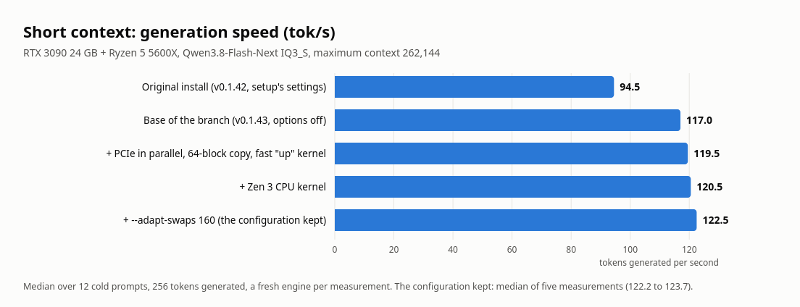
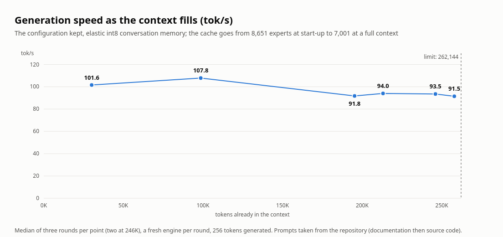
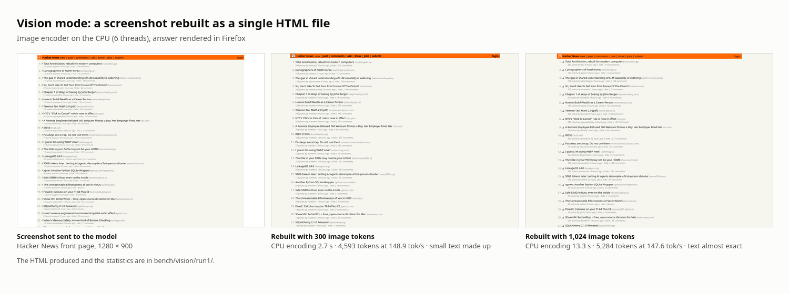

**English** · [Français](RTX3090.fr.md)

# Strata on an RTX 3090: the best settings and vision mode

Everything below was measured on 11 and 12 October 2026 on a single PC: RTX 3090 24 GB (PCIe 4.0 x16, the card also
drives the desktop), Ryzen 5 5600X (6 cores, AVX2), 62 GiB of DDR4, Ubuntu 24.04, kernel 7.0, NVIDIA driver
595.99.02, CUDA 13.2. Model: Qwen3.8-Flash-Next GSQ-RCO IQ3_S, context 262,144, K/V int8, MTP draft, draft
vocabulary `fr`. Engine: the `opt/3090` branch (upstream v0.1.43 + the asynchronous adaptive tier + the options
below). The measurement files are in `bench/results/2026-10-12-rtx3090-max/` and `bench/vision/`.

## Result



| Configuration | Generation speed (tok/s) |
| --- | ---: |
| Original install (v0.1.42, setup's settings) | 94.5 |
| + calibrated settings and `--adapt-async 1` (v0.1.42) | 117.3 |
| Base of this branch (v0.1.43, same settings, options off) | 117.0 |
| + PCIe in parallel, 64-block copy, fast "up" kernel | 119.5 |
| + Zen 3 CPU kernel | 120.5 |
| + `--adapt-swaps 160` (the configuration kept) | 122.2 to 123.7 |

Median over 12 cold prompts (6 in French, 6 in English; text, code, SQL), 256 tokens generated each, a fresh engine
per measurement, 2 warm-up requests. Rows 3 to 5 are the median of three alternated rounds (spread between
rounds: 0.3 tok/s at most); the last row groups five single-round measurements made in five series
(122.2, 122.7, 122.5, 123.7 and 122.2; median 122.5, the value on the figure). The
first two rows come from the previous day's protocol (temperature 0.7), the others from the driver
`tools/strata_ab_linux.py` (temperature 0): both protocols give 117 for the same configuration.

Gain of this branch over its base: about +4.5%. Total gain since the original install: about +30%, most of which
comes from the settings and the asynchronous tier, not from the new code.

## The configuration kept

In `strata-iq3_s.json` (copy: `bench/results/2026-10-12-rtx3090-max/config_rtx3090_max.json`):

```
--max-context 262144 --kv int8 --kv-grow --spec 4 --spec-min-p 0.70
--pcie-frac 0.35 --adapt-every 1 --adapt-swaps 160 --adapt-decay 0.97 --adapt-async 1
--vision --vram-reserve-mib 700
"env": { "STRATA_PCIE_BRANCH": "1", "STRATA_FETCH_BLOCKS": "64", "STRATA_GR_FAST": "1", "STRATA_IQ_ZEN3": "1" }
```

| Setting | What it does | Measurement |
| --- | --- | --- |
| `--adapt-async 1` | the expert cache in VRAM adapts without blocking generation | +14% (v0.1.42: 102.9 → 117.3) |
| `--kv-grow` | the conversation memory grows on demand instead of being reserved for 262K | +6% (94.5 → 100.0, v0.1.42) |
| `--adapt-every 1 --adapt-swaps 160 --adapt-decay 0.97` | the cache is re-evaluated at every window, up to 160 swaps | 160 against 80: +1.6% (twice) |
| `--pcie-frac 0.35` | 35% of the experts missing from the cache are read by the GPU from RAM, the rest is computed on the CPU | 0.25: −2.4%; 0.45: within noise |
| `--spec 4 --spec-min-p 0.70` | 4-token window, a draft goes in if it has at least 70% probability | 0.60: −0.5%; 0.80: −2.5% |
| `STRATA_PCIE_BRANCH=1 STRATA_FETCH_BLOCKS=64` | a layer's PCIe share runs alongside the experts in VRAM; copy over 64 wide blocks | +0.9% at equal work (4 prompts out of 4) |
| `STRATA_GR_FAST=1` | "up" kernel of the hyper-connection read without a latency chain (it was already in the code) | +1.5% at equal work (3 out of 3) |
| `STRATA_IQ_ZEN3=1` | AVX2 decoding without gather for IQ2_S and IQ3_S, multi-token kernel also for a single token | +0.8% (119.5 → 120.5) |

The last three rows together: +3.0% on the real configuration (117.0 → 120.5).

`STRATA_IQ_ZEN3=1` changes the rounding of a single token: the answers are no longer bit-for-bit identical to those of
the default path. The three other variables give the same values by construction; the hyper-connection read
is also checked bit for bit by the engine at every start. End-to-end parity could not be shown
by comparing text (see "What remains open").

## What was tried and not kept

| Trial | Measurement | Decision |
| --- | --- | --- |
| New GPU kernel `STRATA_GR_SM86=1` (the whole row read ahead) | 0.997 at equal work; 112.5 against 113–117 | stays in the code, off |
| `STRATA_GR_ACT_AHEAD=1` (activations ahead) | 0.995 at equal work | off |
| `--spec 5 --spec-cum-p 0.45` (cumulative-probability rule) | 112.6 against 120.8 | off |
| `--spec 5 --spec-cum-p 0.60`, `--spec 6 --spec-cum-p 0.50` | 114.7 and 114.8 | off |
| Personal expert profile (30 French and code prompts, distinct from the benchmark) | 120.7 against 120.8; hit rate 93.9% against 94.2% | no effect on short cold answers |
| `--adapt-swaps 240`, `400` | 121.8 and 120.8 | 160 kept |
| `--adapt-decay 0.95`, `0.99` | 120.2 and 113.8 | 0.97 kept |
| `--pool-workers 5` | 120.8 | no effect |
| `--vram-reserve-mib 500` | 119.6 | 700 kept |
| `--lookup-chain 0` | 120.7 | no effect |
| `STRATA_PCIE_MIN1=1`; with `--pcie-frac 0.6` | 120.5; 117.9 against 123.7 | off |
| `STRATA_FS_SLOTS=2` (look-ahead slots) | 111.1 against 123.7; `=4`: HTTP error 400 | off |
| `STRATA_Q2_BITPLANE=1` | 123.4 and 122.8 against 122.5 and 122.2 | within noise |
| `STRATA_EXCHANGE_ROTATE=1`, `STRATA_ADAPT_LAG=2` | 122.4 and 122.3 against 122.5 | no effect |
| `STRATA_ADAPT_ASYNC_DEMAND=1` | 119.0 against 122.5 | off |
| `STRATA_IQ_MT_MIN=1` | 121.1 against 122.5 | off |
| `--mtp-q4 all`, `proj` (draft layer in 4 bits) | 120.3 and 117.9 against 122.2 | off |
| `--kv k8v4` at a long context | see below | `int8` kept |
| `--pool-tasks 12`, `36` (how the CPU rows are split) | 122.8 and 122.8 against 122.8 | no effect |
| `STRATA_DF_BRANCH=1`, `STRATA_DF_PDL=1` (side branches, early launch) | 123.2 and 122.9 against 123.1 | no effect |
| `STRATA_LFUSE=1`, `STRATA_GDN_SPLIT=1`, `STRATA_TSUM=1`, `STRATA_VERIFY_QDEDUP=1`, `STRATA_Q8_PACKED=1` | 122.6 to 122.8 against 123.1 | no effect |
| `STRATA_FUSE_HEAD_GR=1`, `STRATA_Q6_PACKED=1` | 120.8 and 118.6 against 123.1 | off |
| `STRATA_ROUTE_RESIDENT=0.5` (routing biased towards the cache; changes the outputs) | 120.6 against 123.1 | off |
| Huge pages (24,000 × 2 MiB) | 93.9 against 94.5 | dropped |
| GPU persistence mode, locked frequencies, `performance` governor | −2.4% | dropped |
| `--pcie-mode dma`, `direct` | 84.0 and 113.1 against 118.3 | dropped |
| `STRATA_QFUSE=1` | 95.4 against 115.1 | dropped |
| XeStrata xe0.1.42 (container) | 101.5 to 104.4 | not faster than Strata v0.1.42 here |

Yet the personal profile covered the offline routing better (79.9% against 55.7% on held-out prompts).
The likely explanation, not isolated: the adaptive tier catches up with the right cache during the warm-up requests.

## Long context and long answers



The configuration kept, a single engine, four prompts of growing length taken from the repository (documentation then
source code) followed by a question, 256 tokens generated. The common prefix is reused from one request to the next.

| Prompt tokens | of which re-read | Prompt reading (tok/s) | Generation `int8` (tok/s) | Generation `k8v4` (tok/s) | Experts in cache (`int8`) |
| ---: | ---: | ---: | ---: | ---: | ---: |
| 30,105 | 30,105 | 2,476 | 101.6 / 101.8 / 101.1 | 102.9 / 103.0 / 102.9 | 8,545 |
| 98,610 | 82,226 | 2,385 | 107.8 / 108.5 / 106.8 | 106.1 / 106.3 / 105.4 | 8,057 |
| 195,234 | 96,930 | 2,174 | 104.3 / 90.4 / 91.8 | 94.8 / 96.5 / 95.4 | 7,437 |
| 213,135 | 32,911 | 1,969 | 92.1 / 97.0 / 94.0 | 98.2 / 100.2 / 93.5 | 7,275 |
| 246,041 | 33,049 | 1,870 | 93.1 / 93.9 | 93.2 / 95.2 | 7,057 |
| 257,886 (K/V full: 262,144 cells) | 44,894 | 1,911 | 93.0 / 90.2 / 91.5 | not measured | 7,001 |

Three rounds per row (two at 246K), a fresh engine per round; the last row comes from `long3_full.jsonl`, where the
213K prompt is read in one block (2,260 tok/s, 94 s) then extended to 257,886 tokens. With the context full, the
conversation memory fills its 262,144 cells (3.35 GiB), the cache has given back 1,650 expert slots (8,651 at start-up, 7,001 left) and generation
holds 91.5 tok/s in median, about 25% less than at a short context on different prompts.

### Settings tried at a full context

A 257,886-token prompt read in one block, 768 tokens generated, a fresh engine per measurement (`full_tune.txt`).

| Setting | Generation (tok/s) | Prompt reading (tok/s) |
| --- | ---: | ---: |
| The configuration kept (four measurements) | 93.0 / 91.7 / 91.7 / 91.7 | 2,195 to 2,228 |
| `--kv-resident 20480` (K/V in RAM, 20,480 cells in VRAM) | 96.2 / 92.5 / 95.1 | 2,173 |
| `--kv-resident 32768` | 93.7 | 2,161 |
| `--kv-resident 65536` | 94.4 / 94.6 / 94.4 | 2,151 to 2,167 |
| `--pcie-frac 0.5`; `0.2` | 93.6; 91.7 | 2,235; 2,222 |
| `--adapt-swaps 80`; `320` | 93.0; 90.6 | 2,212; 2,202 |
| `--kv k8v4`; `--kv q4_0` | 91.6; 89.4 | 2,069; 2,111 |

Keeping the K/V in RAM (`--kv-resident`) is the only setting that stands out at a full context: about +3%, with a cache
at a 95.1% hit rate against 93.0%. Setup had turned it off, judging the RAM too tight; it fits in
62 GiB. But it does not gain elsewhere: on the 30K to 246K ladder (`long4_kvres20.jsonl`, two rounds),
`--kv-resident 20480` gives 101.9 / 101.6 at 30K, 102.4 / 99.4 at 99K (against 106.8 to 108.5), 91.9 / 94.8 at 195K,
98.5 / 91.6 at 213K and 93.5 / 94.2 at 246K; at a short context 119.2 and 120.6 against 121.3 and 121.0; and reading the
prompt is 3% slower. So it is not kept by default. It can serve someone who works near the context limit all the
time.

`--kv k8v4` (a more compact memory: 2.57 GiB instead of 3.25 at 254K cells, 363 more experts in cache) cannot be told
apart from `int8` in generation (differences of 0 to 3%, within the noise between rounds) and reads the prompt 7%
slower: `int8` is kept.

An answer of 2,500 tokens in one go (an explanation with code examples) comes out at 124.8 tok/s.

## Parity of the "same values" options

Under `STRATA_DETERMINISTIC=1 --adapt-swaps 0`, with the cache and the prefill fixed, six configurations gave exactly
the same text on 12 prompts out of 12 (256 tokens): the base, `STRATA_PCIE_BRANCH=1 STRATA_FETCH_BLOCKS=64`,
`STRATA_GR_FAST=1`, the two together, `STRATA_GR_SM86=1` and `STRATA_GR_ACT_AHEAD=1` (second round of
`speed2_det.jsonl`). Three engines started again later give this text again, and four others agree at 128 tokens
(`det_bisect.txt`).

## Deterministic mode: the cause of the remaining variation

In the `speed2_det` series, the answers formed three groups of consecutive engines. Their logs show three
cache sizes: 8,687, 8,688 and 8,703 slots, for the same `--expert-cache 8400`. A cache requested close to what
fits in VRAM is reduced by the engine according to the VRAM free at start, and that varies by a few MiB with
the desktop. One expert more or less in the cache changes the split between GPU and CPU, and so the rounding.

With a clearly smaller requested cache (`--cache-slots 5200`, elastic K/V off), six engines started under
three different VRAM reserves (700, 900 and 1,100 MiB) opened the same cache (6,793 slots) and gave the
same answers on 12 prompts out of 12 (`det_nogrow.txt`). At `--cache-slots 6300`, the three reserves gave three
sizes (7,068, 6,964, 6,860) and three sets of answers.

With the asynchronous adaptive tier on (160 swaps per window, like the configuration kept) and this same fixed
cache, three fresh engines also give the same answers on 12 prompts out of 12 (`det_adapt.txt`).

The driver now turns the elastic K/V off in deterministic mode and warns when the engines of a series did not open the
same cache; the engine warns if `--kv-grow` is on under `STRATA_DETERMINISTIC=1`. Outside deterministic mode (the
serving configuration), the text varies from one start to the next: the cache size follows the free VRAM there and the
lookup drafts follow measured times.

## Where the time goes

A verify window lasts about 26 ms and validates 3.3 tokens. The engine spends 13.9 ms waiting for the GPU, 9.5 ms in the
experts computed on the CPU and 1.6 ms in the draft (profile of v0.1.43, `--adapt-async 1`). The cache keeps about 8,440
experts in VRAM (16 GiB) and serves 91 to 94% of the calls; each missing expert costs a CPU computation of about 0.2 to
0.35 ms on one thread or a PCIe read.

A `perf` profile of the engine during a 2,500-token answer (`cpu_profile_decode.txt`): 63% of the CPU samples
are in the wait loop of the six compute threads, 10% in the host thread waiting on the GPU's flags, and
about 23% in the expert kernels. So the threads are idle two thirds of the time.

The per-layer detail (`bench/results/2026-10-12-rtx3090-latency/`, `STRATA_DECODE_TIMING=1 STRATA_POOL_STAMPS=1`, one
prompt, 109 windows of 20.8 ms) shows that this idle time is the time during which the GPU is working, not a
loss in how the work is split:

| Per layer, host side | Time |
| --- | ---: |
| GPU plan, quantisation of the activations, preparing the tasks | 5 µs |
| gate/up rows of the missing experts (6 threads, 18 slices) | 100 µs |
| down rows | 48 µs |
| synchronisation between threads (both phases) | 0.8 µs |
| total | about 155 µs, of which 148 of computation |

A missing expert costs about 80 µs of computation on six threads, at the speed of decoding the quantised weights (4.3
GB/s per thread). On the GPU side, the visible wait for the missing experts is 4.5 ms per window (1.8 for the CPU rows,
2.7 for the PCIe share); the rest, 13 to 14 ms, is the time of the GPU kernels themselves. Removing a wake-up hop,
splitting finer or merging the two phases would bring 0.2 to 0.4% at most: none of that was coded. `--pool-tasks 12` and
`36` measure 122.8 against 122.8.

The graph of a 4-token window has 2,158 nodes (`graph_nodes_4tok.txt`). With empty nodes added to
each layer (`STRATA_DUMMY_NODES`), the speed goes from 122.5 to 120.8 tok/s (10 per layer) then to 115.7 (40 per
layer): about 0.86 µs per node, that is 1.9 ms per window for the whole graph (7%). This is the upper bound of
what a fusion of kernels could give back; the partial fusions already present (`STRATA_LFUSE`, `STRATA_GDN_SPLIT`,
`STRATA_TSUM`) change nothing in the measurement.

What bounds the speed on this machine, in order: the time of the GPU kernels (reading the weights in VRAM, at every
window), the number of tokens validated per window (it depends on the draft model) and the number of experts missing
from the cache (it depends on the free VRAM). None of the three can be set by a parameter: about fifty settings and
switches were measured (CPU, cache, GPU graph), and the four kept give +4.5% together. Beyond that, the gain goes
through hardware (more VRAM or a second card for the cache, a faster CPU for the missing experts).

## Vision mode

The model has an image encoder (0.9 GB) that setup adds with `--vision cpu` or `--vision gpu`. Here it runs
on the CPU (6 threads): it takes no VRAM, and the expert cache keeps the same size (8,439 experts with
vision, 8,441 without). The 700 MiB of `--vram-reserve-mib` that setup writes with vision are the engine's
default reserve, not an extra cost.

### Benchmark: a screenshot rebuilt as one HTML file



`bench/vision/vision_bench.py` sends a 1280 × 900 screenshot of the Hacker News front page with the request to
rebuild it as a single self-contained HTML file, thinking off, temperature 0. It keeps the answer, the HTML, a rendering
of the HTML by Firefox and the timings in `stats.jsonl`.

| Image tokens at most | Prompt tokens | Encoding (CPU) | Tokens generated | Speed | Drafts accepted | Total time |
| ---: | ---: | ---: | ---: | ---: | ---: | ---: |
| 300 (default of the CPU mode) | 376 | 2.7 s | 4,593 | 148.9 tok/s | 93.5% | 34.5 s |
| 1,024 | 1,084 | 13.3 s | 5,284 | 147.6 tok/s | 93.7% | 50.8 s |

Both answers are complete HTML pages that render.

- At 300 tokens, the layout, the header bar and most of the titles are right, but the small text is made up:
  domains, authors and counters are wrong, and one title is replaced ("IRCv3" becomes "RICO (1970)").
- At 1,024 tokens, the text is almost entirely exact, small print included, with a few letter mistakes
  ("jtnr" for "jttnr", "apswo" for "apsw"). The rendered page is a little narrower than the original.

Two other pages, same protocol, with the configuration kept (`bench/vision/run2/`, cap of 8,000 tokens):

| Page | Image tokens | Encoding (CPU) | Tokens generated | Speed | Result |
| --- | ---: | ---: | ---: | ---: | --- |
| The "Nvidia" article of the French Wikipedia | 300 | 2.8 s | 8,000 (cut at the cap) | 150.9 tok/s | incomplete HTML |
| | 1,024 | 13.3 s | 5,330 | 142.8 tok/s | complete page: table of contents, tabs, text of the introduction and infobox right; logo and photo replaced by shapes; right column displaced |
| python.org home page | 300 | 2.7 s | 2,985 | 145.0 tok/s | complete page |
| | 1,024 | 13.3 s | 3,762 | 139.7 tok/s | complete page: navigation bars, banner, slogan and the four columns with their text; simplified logo |

The images of the source page are not reproduced (the instruction forbids external files): the model replaces them with
flat colour areas or simple shapes. The renderings at 300 tokens of these two pages were not compared in detail with the
original.

So rebuilding a page from a screenshot takes 1,024 image tokens: the configuration kept puts
`"max_tokens": 1024` in the `vision` section. The cost is about 10 s more encoding per new image; an
image already sent is not encoded again. To describe a photo, 300 is enough and answers faster.

The speed rises to 148 tok/s on this test because HTML is repetitive: 93% of the drafts are accepted, against 70 to
80% on ordinary text.

To run the test again:

```
python bench/vision/vision_bench.py CONFIG.json bench/vision/site_hn.png bench/vision/run2 --tag hn --image-tokens 300,1024
```

The server in service must be stopped first: two engines do not fit in 62 GiB of RAM.

## Measure it yourself

`tools/strata_ab_linux.py` compares engines or settings: a fresh engine per arm, 12 prompts, port 18080.

```
export STRATA_DIR=~/Documents/strata STRATA_AB_CONFIG=~/Documents/strata/strata-iq3_s.json
python tools/strata_ab_linux.py speed --no-deterministic --rounds 3 --max-tokens 256 \
    --arm 'base' --arm 'trial;env=STRATA_X=1;arg=--flag value'
```

With `--no-deterministic`, the texts change from one start to the next and only the per-round medians can be compared;
they reproduce here to within 0.3 tok/s. Without this option, the driver turns on `STRATA_DETERMINISTIC=1` and compares
the prompts whose text is identical.

## What remains open

- **The blocking tier of v0.1.43** measures 83.4 tok/s here against 102.7 in v0.1.42; the cause is not isolated. The
  configuration kept uses the asynchronous tier and is not affected.
- **Long sessions.** The full context is measured on prompts read in one block; a real conversation of several
  hours, with many turns, is not.
- **Backends.** Only the CUDA sm_86 build under Linux was compiled and run; neither HIP, nor SYCL, nor Windows.
- **Profile tools** (`tools/profile_personal.py`, `tools/vram_budget.py`): they work, but the profile brought no
  speed here.
