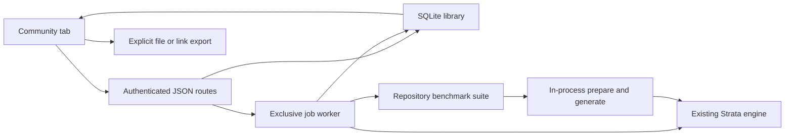
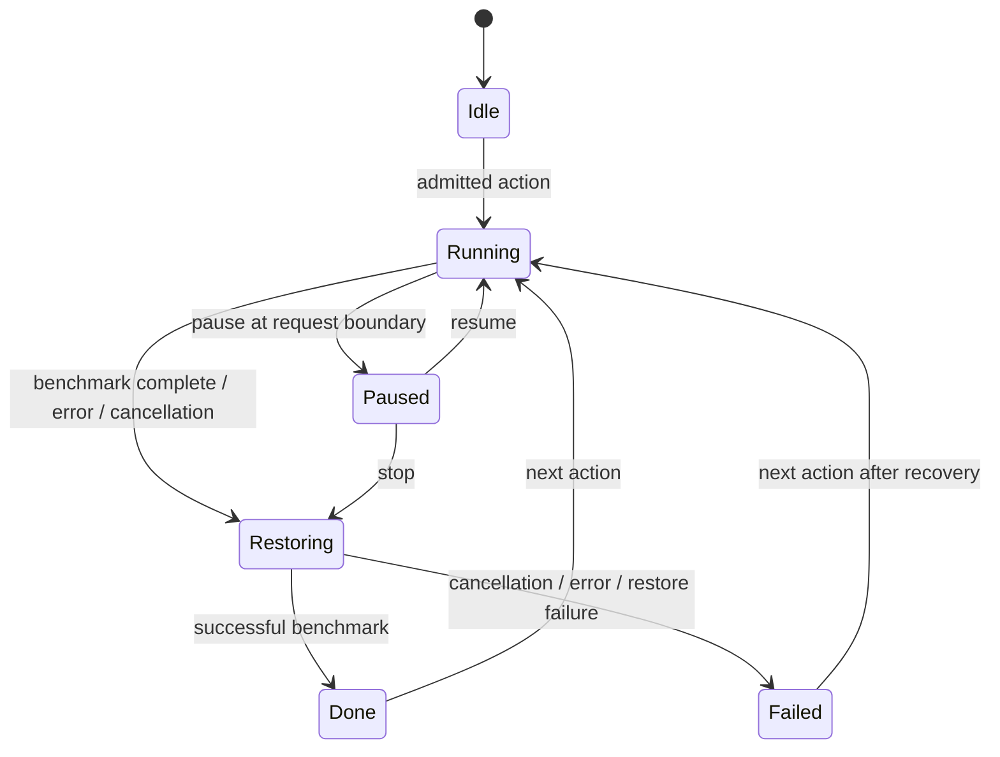

# Community V0 — maintainer guide

This guide describes the implementation on `codex/community-configs-0144`, based on
upstream Strata 0.1.44. It is an optional local configuration library and comparison
workspace inside the existing portal. It is not a hosted community service.

For startup commands, the user workflow, benchmark definitions and measured validation,
see [README.md](README.md). GPU references and their sources are in
[GPU-SOURCES.md](GPU-SOURCES.md). No engine source, model implementation or default
tuning is changed by this feature.

## 1. Product boundary

The user can save their current setup, import another person's tuning, filter the
library, keep favorites, rate entries, load a preset for the session, benchmark it
against their current settings, and export the result. The portal retains Strata's
fonts, design tokens, navigation, themes and authentication. There is no frontend
framework, CDN, account system, cloud upload, package installation or new Python dependency.

Sharing is explicit: download a JSON file or copy a self-contained link and send it
outside Strata. An empty nickname becomes `Anonymous`. Hardware and free-text fields
remain visible to recipients. Anonymous does not mean that identifying information
entered in a description is removed.

The V0 UI presents single and heterogeneous multi-GPU PCs. RAM capacity is metadata;
unknown memory type stays unknown. Mac, unified-memory and cluster records remain
readable in the interchange format but are hidden in the main browser. Importing any
hardware description never changes this server's physical devices or model.

## 2. Enable, disable and recover

Launch the feature checkout with your existing environment and private run config:

```sh
python -m serve.server --engine strata --config /absolute/path/to/run-config.json \
  --host 127.0.0.1 --port 8080 --community-db /absolute/path/to/community.sqlite
```

Open `http://127.0.0.1:8080/#community`. Stop another inference server first: two copies
of this model may not fit in memory. The normal vision helper belongs to the same
server; it is not a second language-model engine.

Without `--community-db`, the tab is hidden, the database is not opened, and the
Community admission gate is not installed. Community routes return 404. Loading or
benchmarking a preset never writes the private run-config file. Restarting the server
returns to that file's configuration and clears session-only undo state.

Keep the database outside Git. To back it up, stop the server and copy the SQLite
file, then restart with the same path. No automatic retention/deletion or sync is
implemented. The history API shows the newest 100 comparisons; older records remain
in SQLite. A future database version is refused rather than silently downgraded.

If restoration fails, the UI reports it explicitly. Stop testing and restart the
server with the original run config. A browser refresh alone cannot repair an engine
startup failure. Server logs contain diagnostic details; shareable errors omit local
paths and engine log contents.

## 3. Code map and data flow

| File | Responsibility |
| --- | --- |
| `serve/community.py` | Validation, SQLite, hardware snapshot, admission, jobs, restart/restore, measurements |
| `serve/server.py` | Optional CLI flag, route/auth/body checks, mutating-request admission |
| `serve/web/app.js` | Exposes the tab only when health advertises Community |
| `serve/web/index.html` | Existing portal plus Community panels and native dialogs |
| `serve/web/community.js` | Library, filters, editor, inspection, sharing, polling |
| `serve/web/community-bench.js` | Benchmark selection, controls, history, charts and JSON download |
| `serve/web/community.css` | Scoped responsive styles using existing Strata tokens |
| `serve/data/community-gpus.json` | Vendor-sourced descriptive GPU catalog |
| `tools/strata_bench.py` | Existing suite; optional request transport injection for Community |
| `serve/test_community.py` | Library, integration, security and lifecycle tests without a GPU |



The UI fetches state on entry, on refresh and after actions. While a job runs it polls
about once per second. Closing a dialog does not cancel the job. Reloading the page
rediscovers a running job and its progress. There is one active engine job per server.

## 4. Save and hardware capture

`save` snapshots the same telemetry used by Your PC and Model & engine:

- GPU names and each device's total VRAM, for devices visible to the server telemetry;
- CPU name, OS and OS-visible RAM capacity;
- loaded model name, reported engine version, context, KV format and vision flag;
- available expert-slot, pool-worker, CPU-core and thread metadata;
- the seven supported tuning values from the engine's trusted spawn arguments.

The run-level runtime snapshot is taken before its paired restarts; expert-slot counts
are not captured separately for each arm.

The default flow needs only a name. The form offers optional nickname/description,
manual hardware corrections and expandable tuning fields. Blank tuning values mean
inherit the current server setting when applied; saved explicit values override it.
This is a tuning preset, not a complete portable installation.

RAM type uses unprivileged Linux EDAC when available, or a locally declared value.
There is no `sudo dmidecode`, CPU-generation guess, machine hostname or full hardware
fingerprint. OS-visible capacity may be lower than installed capacity. Hardware
metadata is descriptive and may be user-corrected; it is not a verified attestation.

## 5. Library and interchange

SQLite `PRAGMA user_version` is **1**. Each operation opens its own connection with
a 10-second busy timeout, a transaction and parameterized SQL. Connections are not
shared between request threads.

| Table | Columns / purpose |
| --- | --- |
| `configs` | `id`, unique `fingerprint`, normalized JSON `document`, `origin`, `added`, private `favorite`, private `rating` |
| `runs` | `id`, `config_id`, `created`, JSON `document` containing a completed baseline/candidate comparison |
| `gpus` | `id`, reference JSON `document`; seeded/refreshed from the bundled catalog at startup |
| `local_meta` | `key`, `value`; currently the locally declared RAM type |

Import validates before insertion and compares normalized documents, including numeric
value equality (`24` and `24.0`). Reimporting the same bundle returns the existing ID.
This does not merge distinct presets by title: a changed date, measurement or description
can produce another entry. A SHA-256 fingerprint is a deduplication key, not a signature.

A schema-1 bundle contains `title`, `author`, `description`, `published`, `model`, `rig`,
`settings`, optional `runtime`, and up to eight `results`. Required title/model are
nonempty. Limits include 80 characters for title, 40 for author, 500 for description;
control characters, unknown fields, non-finite numbers and executable/path/env settings
are refused. See `bundle`, `validate_rig`, `validate_runtime` and `validate_result` for
the complete executable schema.

`rig.gpus` has 1–16 cards, with per-card VRAM. Legacy single-GPU fields are accepted.
The compatibility schema can describe up to 16 node groups of 1–64 nodes with their
own hardware; no network addresses, credentials or remote execution are supported.
Unified memory is not advertised as dedicated VRAM or pooled cluster capacity.

Private IDs, origin, favorites and ratings are removed on bundle export. A selected
completed run can attach **only its candidate measurements**, effective tuning and
measured rig. Import stores these as reported figures, never as local `runs`. A raw
comparison download instead includes both arms, settings, timestamps and protocol.

Portable links encode the sanitized JSON in a `setup` query parameter (maximum 16,000
encoded characters). The destination shows an import confirmation before adding an
entry. It never loads settings or starts a benchmark. Recipients use their own server
host/port. Larger bundles use JSON files; there is no online link-shortener or registry.

## 6. Tuning and engine lifecycle

Only these numeric flags can be replaced:

| Flag | Accepted range | Meaning |
| --- | --- | --- |
| `--pcie-frac` | 0–1 | Existing engine PCIe allocation setting |
| `--spec` | integer 0–8 | Existing speculative generation setting |
| `--spec-min-p` | 0–1 | Existing draft acceptance threshold |
| `--adapt-every` | integer 0–100 | Cache adaptation interval |
| `--adapt-swaps` | integer 0–256 | Cache adaptation swap limit |
| `--adapt-decay` | 0–1 | Cache adaptation decay |
| `--prompt-cache` | integer 0–6 | Conversation-cache slots |

Ranges are input validation, not a promise that every combination improves performance.
The executable, working directory, environment, model files, context capacity, GPU
selection, layer split and other flags come from the trusted local spawn specification.
A different model name is rejected. Replica/batch engines are refused by the V0 job path.

- **Load configuration**: restart with a copy of the current spawn and whitelisted
  replacements; retain the previous spawn/active ID for undo.
- **Undo**: restart the immediately preceding configuration, then consume that one undo
  level. Loading A then B then undo returns to A, not necessarily the startup config.
- **Reload model**: restart current settings; preserve the existing undo target.
- **Benchmark**: restart baseline, measure; restart candidate, measure; restore the
  original spawn in `finally`. It does not adopt the candidate or overwrite undo history.

The worker disables idle unloading while active. Restarts use the existing engine
restart method under the service FIFO lock. There is no shell command constructed from
a shared preset and no side-by-side engine launch.

## 7. Job state, concurrency and cancellation

Jobs expose `state` (`idle`, `running`, `done`, `failed`), `action`, configuration ID,
scenario, phase, start timestamp, measured progress, pause flags and optional run ID/error.
No persistent job queue or restart-after-crash mechanism is implemented.



The admission gate is installed only when Community is enabled. It serializes **all
ordinary POST mutations**, including inference, against jobs. Concurrent ordinary
mutations return HTTP 409; a conflicting Community engine action returns 400 with a
busy explanation. Read-only state and telemetry remain available. This also means V0
is designed for one sequential local engine, not a multi-user inference service.

Pause is cooperative, between complete requests; it does not interrupt an engine
restart. The current request may finish before `paused` becomes true. Resume preserves
cache state. Stop signals cancellation, exits the request/checkpoint and restores the
original spawn. Once restoration is underway, pause/resume/cancel are refused. Each
request has a 300-second cancellation timer. Engine restart time is separate.

A run is written only after both arms complete and pass the final cancellation check.
The original engine is then restored. If restoration fails after successful measurement,
the completed measurements can still exist, but the job is failed and reports recovery
instructions. Cancelled/partial measurements are not saved as successful comparisons.
A process crash cannot execute `finally`; restart with the original config to recover.

## 8. Benchmark and chart interpretation

The catalog is fixed: quick cold/warm code, three repository chat questions, repository
4K/16K prompts, or a six-turn repository coding conversation. See the scenario table in
[README.md](README.md) for caps and exact suite methods. There is no arbitrary benchmark
path, user script, tool execution or online workload download.

Repository scenarios call the existing `Suite` using an injected in-process transport.
They retain its warm-up, prompt-length calibration and fixtures. Each setup runs once;
the CLI's normal HTTP transport and three-pass default remain unchanged. A shared nonce
aligns both arms. Agent continuations use each arm's answers, so subsequent inputs can
differ. Configured 256K capacity does **not** mean that a 4K/16K scenario fills 256K.

Measurements use greedy sampling, seed 42 and thinking disabled. Stored fields include:

| Field | Interpretation |
| --- | --- |
| `ttft_s` | Request preparation to first nonempty streamed text; excludes engine load and HTTP transport |
| `decode_tok_s` | Engine-reported completed-request generation rate; absent means unavailable |
| `duration_s` | Measured request duration, excluding pause/warm-up/restart |
| `prompt_tokens`, `output_tokens` | Actual request/response token counts |
| `reused_tokens`, `read_tokens`, `prompt_tok_s` | Cache/prefill timings reported by the engine, when available |
| `ram_peak_gib`, `vram_peak_gib`, `gpu_peaks` | Sampled whole-system/device memory usage, not process RSS or allocator peaks |
| `answer_sha256` | Output-text digest for difference detection, not a correctness grade |
| `simulated` | Mock-engine measurements must not be used as real performance evidence |

Telemetry refreshes about once per second and the measurement reads it every 200 ms.
Short memory peaks can be missed; startup peaks are outside the sampling window.
Existing desktop/browser usage contributes to system/device totals. Cold means a fresh
engine cache, not flushed SSD/OS caches. Do not add unified RAM and VRAM totals.

Charts use a shared zero-based scale per metric. Percentages require real measurements,
the same protocol and matching prompt-token counts. Equal token counts do not prove
identical text or output quality. Cards use the warm phase when present, otherwise the
last request; they show its label/date, not a scenario average or a predicted speedup.
History allows the full paired comparison to be inspected and exported. Stars show a
personal score and 0/1 local votes; they are not aggregated community ratings.

## 9. HTTP API reference

All routes reuse the server's configured API key. JSON POSTs require the existing
same-origin/trusted-origin check; CLI requests without Origin are accepted subject to
authentication. Body size is at most 128 KiB (or the lower server limit). Never expose
the server beyond loopback without `--api-key`.

| Method and path | Body / result |
| --- | --- |
| `GET /community/state` | Library, last 100 runs, catalog, hardware/runtime, current tuning, allowed knobs, job and undo availability |
| `POST /community/save` | `{title, author?, description?, settings?, rig?}` → `{id}`; default hardware/runtime captured locally |
| `POST /community/import` | Schema-1 bundle → `{id}`; no engine action |
| `POST /community/export` | `{id, author?, run_id?}` → sanitized bundle; a run must belong to that entry |
| `POST /community/preference` | `{id, favorite?, rating?}` → `{ok:true}`; rating integer 0–5 |
| `POST /community/benchmark` | `{id, benchmark:"quick"|"chat"|"context"|"agent"}` → job accepted; default `quick` |
| `POST /community/adopt` | `{id}` → session load job |
| `POST /community/restore` | `{}` → one-level undo job |
| `POST /community/reload` | `{}` → current-settings reload job |
| `POST /community/pause` | `{}` → pause requested |
| `POST /community/resume` | `{}` → resume requested |
| `POST /community/cancel` | `{}` → cancellation requested |

Configuration IDs are 32 lowercase hexadecimal characters. Invalid types and malformed IDs
return JSON 400 before database access or engine mutation.

A 200 response to a job action means accepted, **not finished**; poll `state.job`.
Validation failures return 400; unauthenticated requests 401; foreign browser origins
403; wrong POST media type 415; oversized bodies 413. A disabled feature returns 404.
UI errors use the existing toast system, while job errors remain visible in the desk.

## 10. Frontend layout and accessibility

The main library uses the available page width, with grid/list choice persisted in
localStorage. Filters search metadata, GPU topology, OS, date, RAM, favorites and
personal rating. On small screens advanced filters collapse behind one control.

Each native `<dialog>` has an accessible title. The shell clips to its rounded border;
a separate inset body scrolls, with overscroll containment. Header/close controls stay
visible and the editor's save/cancel footer remains reachable. Wide tables scroll inside
a labeled, keyboard-focusable region, rather than widening the dialog. Background library
scrolling is disabled while a Community dialog is open. Native Escape/focus containment
remain in use; focus outlines, light/dark themes and reduced-motion styles are retained.

## 11. Validation and future maintenance

Run the existing regression set without GPU downloads:

```sh
python -m unittest serve.test_community serve.test_runconfig serve.test_security \
  serve.test_lifecycle serve.test_server tools.test_strata_bench -q
node --check serve/web/community.js
node --check serve/web/community-bench.js
```

Review the latest validation section in README for actual counts, hardware, raw result
files, browser coverage and exclusions. For a new scenario, add it to `BENCHMARKS` and
`PROTOCOL_PHASES`, keep protocol IDs versioned, bound runtime/context, verify cancel and
restore, and update both chart labels and documentation. Never import a command from a bundle.

Before promoting this to a hosted service, add explicit publication consent, authenticated
writes, independent vote identities, abuse/rate limits, server-side provenance, pagination,
schema migration and data-retention policy. Today's private SQLite stars and imported numbers
must not silently become verified global ratings or hardware-normalized predictions.
